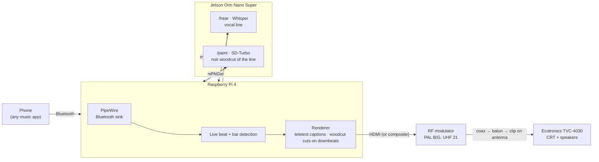

# Boombox Visuals

**A 1980s TV boombox that reads the lyrics and shows them in pictures.**

An Ecotronics TVC‑4030 (a ghetto blaster with a tiny black‑and‑white TV built in) plays whatever you stream to it over Bluetooth through its original speakers. While the song plays:

- **Whisper** listens live and transcribes the vocal line. It appears on the CRT as **blocky 1980s European teletext subtitles**, like PAL TV captions.
- **SD‑Turbo** paints a **high‑contrast graphic noir woodcut** that illustrates the *literal words being sung*.
- The picture **cuts on the music's bar lines**: each new image waits for the next downbeat, then replaces the old one with a hard cut.

Everything runs locally, on a Raspberry Pi 4 hidden behind the boombox and an NVIDIA Jetson Orin Nano Super. The picture and sound reach the boombox as a real analog PAL TV signal through its telescopic antenna, because the boombox has no inputs.



## How it works

1. You stream music from your phone to **Boombox** over Bluetooth. The Pi plays it out of HDMI into the RF modulator, which feeds the boombox's TV tuner, so the sound comes out of the original speakers.
2. The Pi listens to its own output and detects the kick drum every 11 ms. It counts beats into bars (every 4th beat is a downbeat).
3. Every 2 seconds it sends the last 5 seconds of audio to the Jetson. **Whisper** returns the vocal line, which appears at once as teletext captions: double‑height pixel letters in black boxes, the newest two rows.
4. When a **new** line is sung (not the same line heard again), the Pi asks the Jetson for a picture. **SD‑Turbo** paints *"illustration of the words: '…'"* as a stark noir woodcut in one step (~1–2 s).
5. The image is posterised to a few flat greys, like a print. It is held back until the **next downbeat** and then hard‑cut in, with a small punch‑in on every beat.

Without the Jetson, the boombox shows a beat‑reactive circle instead.

## Repository layout

| Folder | What's in it |
| --- | --- |
| [`pi/`](pi/) | Runs on the Raspberry Pi: beat/bar detection, renderer (teletext, woodcut cuts, beat circle), Jetson client, Bluetooth pairing, installer, TV‑output switch |
| [`jetson/`](jetson/) | Runs on the Jetson: the dream server (`/hear` Whisper, `/paint` SD‑Turbo), setup script, mock mode |
| [`docs/`](docs/) | Setup guides, how it works, troubleshooting, project log |

## Quick start

**Raspberry Pi** (Raspberry Pi OS 64‑bit with desktop, controlled over SSH):

```bash
git clone https://github.com/<you>/boombox-visuals.git
cd boombox-visuals/pi
JETSON_URL=http://jetson.local:8765 bash install.sh
./pair.sh            # then pair "Boombox" on your phone
./restart.sh
```

**Jetson** (JetPack 6.x):

```bash
git clone https://github.com/<you>/boombox-visuals.git
cd boombox-visuals/jetson
bash setup.sh
sudo systemctl start boombox-dream
```

**Try it without any hardware** (Linux with PipeWire/PulseAudio, `pip install numpy pygame pillow`):

```bash
python3 jetson/server.py --mock &       # fake song lyrics, drawn placeholder woodcuts
python3 pi/player.py --windowed --files pi/test_music --jetson http://127.0.0.1:8765
```

Guides: [Raspberry Pi + boombox](docs/setup-pi.md) · [Jetson](docs/setup-jetson.md) · [How it works (technical)](docs/how-it-works.md) · [Troubleshooting](docs/troubleshooting.md)

## Hardware

| Part | Notes |
| --- | --- |
| Ecotronics TVC‑4030 TV boombox | German market, 1980s; B/W CRT, VHF I/III + UHF IV/V, PAL B/G; **no inputs** |
| Raspberry Pi 4 Model B (8 GB), 15 W USB‑C PSU, 64 GB microSD | Player, beat detection, renderer |
| NVIDIA Jetson Orin Nano Super Developer Kit (8 GB) | Whisper + SD‑Turbo |
| NVMe SSD for the Jetson, e.g. Samsung 990 EVO Plus 1 TB (M.2 2280) | Fast model loading |
| HDMI/AV → RF modulator "HDM69" | PAL, audio subcarrier 5.5 MHz, channel 57 (= UHF 21) |
| F‑to‑F coax (0.5 m), 75 Ω → 300 Ω twin‑lead balun, crocodile clip lead | Signal into the telescopic antenna |
| Micro‑HDMI → HDMI cable | Pi → modulator |
| *Optional:* 3.5 mm 4‑pole → 3× RCA (Raspberry Pi pinout) | Native composite PAL → modulator AV IN |

## Status

| | |
| --- | --- |
| ✅ | Pi → HDMI → RF → antenna → boombox: picture **and** sound on the real hardware |
| ✅ | Live beat detection (95–170 BPM test tracks: all beats, ~2 ms latency) and beat circle |
| ✅ | Captions, woodcut requests and bar‑line cuts tested end to end in mock mode (every cut on a downbeat, within 0–80 ms) |
| ⚠️ | CRT doesn't lock horizontally on the HDMI‑derived signal. Next: `pi/tvout.sh composite` with the AV cable |
| ⚠️ | Bluetooth needs a re‑pair since the installer now announces the Pi as a loudspeaker |
| ⚠️ | Jetson AI models not yet run on the real Jetson. Captions lag the singing by ~2–3 s (window + Whisper time) |
| ❌ | Spotify Connect (librespot) dropped: Spotify refuses its audio keys ([librespot#1664](https://github.com/librespot-org/librespot/issues/1664)) |

## How this was built

Planned, coded and debugged in one conversation with Claude (Anthropic): from identifying the boombox in an eBay photo, through checking which parts were already ordered, to remote‑debugging an old CRT from phone videos. The full story, with dead ends and fixes, is in the [project log](docs/project-log.md).

## License

MIT, see [LICENSE](LICENSE).
